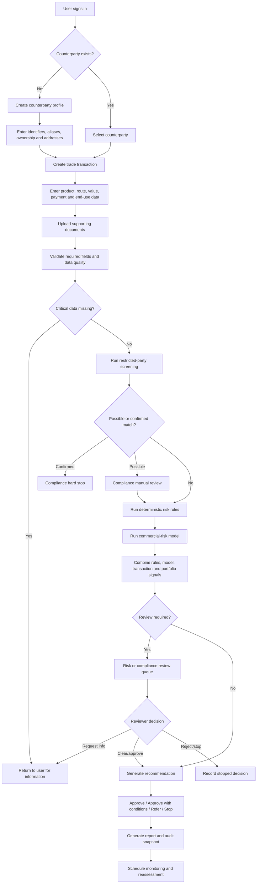
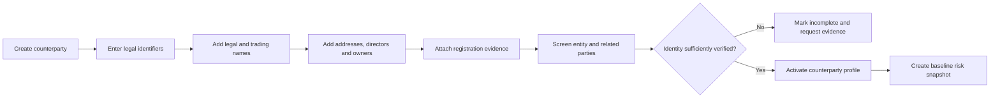
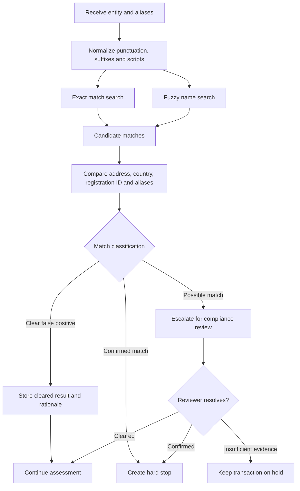
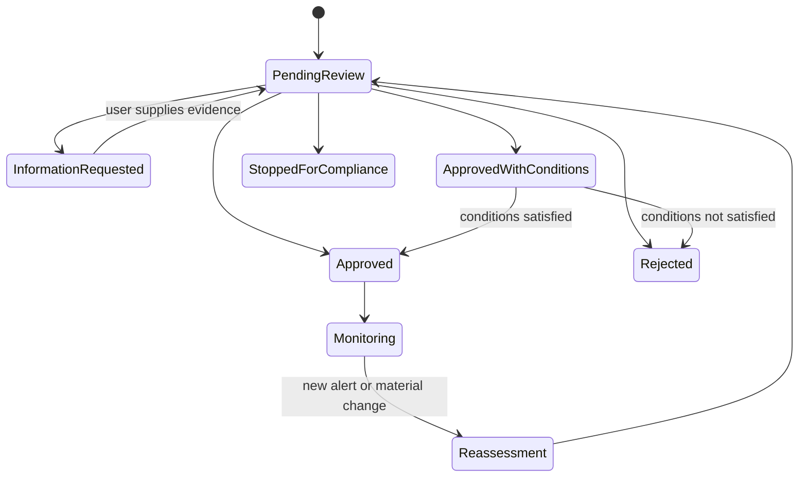
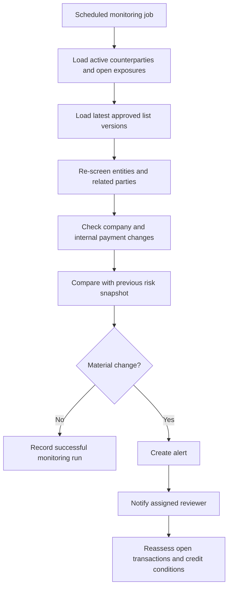
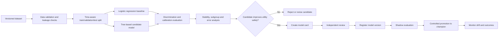

# TradeGuard AI — Product Requirements Document

**Document type:** Product and Software Requirements Specification

**Version:** 1.6

**Status:** MVP through M13 approval-condition tracking implemented; production validation remains out of scope

**Date:** 2026-10-21

**Primary audience:** Product owner, developer, data scientist, reviewer, admissions or hiring evaluator

---

## 1. Executive summary

TradeGuard AI is an explainable cross-border counterparty and transaction risk assessment platform. It helps a small import/export business conduct repeatable due diligence before accepting a new counterparty or approving a trade transaction.

The product combines:

- counterparty identity and business information;
- official restricted-party and watchlist screening;
- configurable deterministic risk rules;
- commercial credit-risk modeling;
- transaction, payment, logistics, and concentration-risk analysis;
- human review, evidence capture, and audit history;
- ongoing monitoring after a decision.

The system is a **decision-support tool**, not an autonomous legal, sanctions, export-control, or lending decision-maker. Compliance hits, missing critical evidence, and low-confidence model results must be escalated to a human reviewer.

---

## 2. Problem statement

Small import/export businesses often evaluate new customers and suppliers using spreadsheets, web searches, messages, and staff experience. This creates several problems:

1. The same checks are performed differently by different people.
2. Search evidence and source timestamps are not retained.
3. Commercial credit risk may be mixed with legal or compliance risk.
4. Long payment terms can be approved without a consistent exposure assessment.
5. Restricted-party matches can be missed or treated as confirmed matches without verification.
6. Decisions cannot easily be explained or audited later.
7. Post-approval changes in a company or official list may not trigger a new review.

TradeGuard AI will centralize this workflow and produce a structured, evidence-backed recommendation.

---

## 3. Product goals

### 3.1 MVP goals

- Create and maintain counterparty profiles.
- Create trade transactions linked to counterparties.
- Import and search approved official screening-list datasets.
- Evaluate transactions using configurable rules.
- Calculate separate risk dimensions rather than one opaque score.
- Generate an explainable recommendation with evidence and reason codes.
- Route uncertain or critical cases to human review.
- Record every material action in an immutable audit trail.
- Export a due-diligence report as PDF.
- Provide a reproducible ML baseline for commercial default risk.

### 3.2 Portfolio and academic goals

- Demonstrate full-stack product development and ML engineering.
- Compare an interpretable baseline model with a tree-based model.
- Evaluate discrimination, calibration, stability, and decision utility.
- Document data provenance, limitations, uncertainty, and ethical constraints.
- Support reproducible experiments and model versioning.

### 3.3 Success indicators

The MVP is successful when:

- a user can assess a new counterparty and transaction end to end;
- each recommendation identifies the evidence and rules that produced it;
- compliance hard stops cannot be overridden silently;
- a reviewer can approve, reject, request more information, or impose conditions;
- a previously completed assessment can be reconstructed from stored versions;
- automated tests cover the critical decision paths;
- the application can be started locally with one documented command.

---

## 4. Non-goals

The MVP will not:

- provide legal advice or guarantee regulatory compliance;
- automatically determine whether an export license is required;
- automatically assign definitive HS codes or ECCNs;
- treat a fuzzy name match as a confirmed sanctions or restricted-party match;
- submit customs, tax, banking, or licensing filings;
- make an autonomous final trade decision;
- scrape authenticated, paywalled, CAPTCHA-protected, or access-controlled systems;
- collect consumer credit reports or unnecessary personal information;
- use an LLM as the final risk decision engine;
- implement microservices, streaming infrastructure, or a large knowledge graph in the MVP.

---

## 5. Product principles

1. **Hard-stop risks remain separate.** A strong financial profile cannot offset a confirmed prohibited-party or prohibited-transaction condition.
2. **Evidence before score.** Every material signal must store a source, timestamp, and explanation.
3. **Human review for ambiguity.** Low confidence, missing data, and possible name matches must be reviewed.
4. **Rules and models are versioned.** A decision must be reproducible using the versions active at the time.
5. **Minimum necessary data.** Store only information required for the defined business purpose.
6. **Models support decisions; they do not conceal policy.** Policy rules, model outputs, and human judgment must be distinguishable.
7. **No silent overrides.** Overrides require a reason, user identity, and timestamp.

---

## 6. Users and roles

| Role | Description | Primary permissions |
|---|---|---|
| Business user | Creates companies and transactions | Create, edit drafts, submit assessments, view results |
| Risk reviewer | Reviews flagged or uncertain cases | Review evidence, request information, apply conditions, approve/reject |
| Compliance reviewer | Resolves restricted-party and export-control alerts | Confirm/clear matches, create hard stops, document rationale |
| Administrator | Manages users, lists, rules, and configuration | Configure rules, manage access, import lists, view audit logs |
| Model developer | Trains and evaluates commercial-risk models | Create candidate model versions and evaluation reports |
| Read-only auditor | Reviews historical decisions | View records, reports, versions, and audit history without modification |

One person may hold multiple roles in a small family business, but the system must still record which role was used for each action.

---

## 7. Scope and release phases

### 7.1 MVP

- Authentication and role-based access.
- Counterparty profiles and aliases.
- Transaction creation and document attachment.
- Manual entry of company-registration evidence.
- Import of approved screening-list files.
- Exact and fuzzy name screening.
- Rule-based transaction assessment.
- Commercial-risk model API and reason codes.
- Human-review queue.
- Decision conditions and overrides.
- PDF report export.
- Audit log.
- Basic dashboard and monitoring.

### 7.2 Phase 2

- Scheduled official-list refresh.
- Company-change monitoring.
- OCR and structured extraction from financial statements and trade documents.
- Portfolio concentration dashboard.
- Email or in-app alerts.
- Model drift and outcome monitoring.
- Bilingual English/Chinese interface and report templates.

### 7.3 Phase 3

- Paid KYB or trade-data providers.
- Relationship graph for companies, owners, addresses, and bank beneficiaries.
- Document discrepancy detection.
- Credit-limit and payment-term optimization.
- Trade-credit insurance and logistics integrations.
- LLM-assisted document summaries with source citations.

---

## 8. End-to-end workflow

### 8.1 Primary transaction-assessment workflow



### 8.2 Counterparty onboarding workflow



### 8.3 Restricted-party screening workflow



### 8.4 Human-review workflow



### 8.5 Ongoing monitoring workflow



### 8.6 Model-development workflow



---

## 9. Decision framework

### 9.1 Risk dimensions

The platform shall calculate and display the following dimensions independently:

| Dimension | Examples | Output |
|---|---|---|
| Identity/KYB risk | Registration inconsistency, unclear ownership, mismatched address | Low/Medium/High/Critical |
| Compliance risk | Restricted-party hit, destination/end-use concern, missing classification | Clear/Possible match/Confirmed concern/Insufficient information |
| Commercial credit risk | Default probability, payment history, financial strength | Calibrated probability plus band |
| Transaction risk | Payment terms, beneficiary mismatch, unusual routing, document gaps | Low/Medium/High/Critical |
| Country/logistics risk | Destination, transshipment, insurance, route disruption | Low/Medium/High |
| Portfolio concentration | Exposure by customer, country, product, currency | Percentage and threshold status |

### 9.2 Recommendation states

- `APPROVE`: No critical issues; risk is within configured policy.
- `APPROVE_WITH_CONDITIONS`: Transaction may proceed only after listed controls are satisfied.
- `REFER`: Human review is required before proceeding.
- `REQUEST_INFORMATION`: Required evidence is missing or inconsistent.
- `STOP`: Internal commercial policy prevents the transaction.
- `COMPLIANCE_HOLD`: A compliance concern must be resolved; the ML score cannot override it.

### 9.3 Example conditions

- Require a larger deposit.
- Reduce order value.
- Shorten payment terms.
- Require an irrevocable letter of credit.
- Require trade-credit insurance.
- Verify bank-beneficiary ownership.
- Obtain end-user/end-use documentation.
- Obtain classification or licensing advice.
- Require management or compliance approval.

### 9.4 Decision precedence

1. Confirmed compliance hard stop.
2. Critical missing or contradictory identity evidence.
3. Critical deterministic transaction rule.
4. Required human review.
5. Commercial model output.
6. Portfolio and operational conditions.

No weighted average may reduce a hard-stop result.

---

## 10. Functional requirements

### 10.1 Authentication and access

| ID | Requirement | Priority |
|---|---|---|
| AUTH-001 | The system shall authenticate users before displaying business data. | Must |
| AUTH-002 | The system shall enforce role-based permissions. | Must |
| AUTH-003 | The system shall record successful and failed login events. | Must |
| AUTH-004 | The system shall support account deactivation without deleting historical actions. | Must |

### 10.2 Counterparty management

| ID | Requirement | Priority |
|---|---|---|
| CP-001 | Users shall create, edit, view, and archive counterparty profiles. | Must |
| CP-002 | Profiles shall support legal names, trading names, previous names, aliases, and multiple scripts. | Must |
| CP-003 | Profiles shall store jurisdiction, registration number, tax identifier when appropriate, addresses, and website. | Must |
| CP-004 | Profiles shall store directors, owners, beneficial owners, and related entities when known. | Must |
| CP-005 | Each factual field shall support a source reference and verification status. | Must |
| CP-006 | Potential duplicate counterparties shall trigger a warning. | Should |
| CP-007 | Archived counterparties shall remain available to auditors. | Must |

### 10.3 Transaction management

| ID | Requirement | Priority |
|---|---|---|
| TX-001 | Users shall create a transaction linked to buyer, seller, beneficiary, consignee, and end user as applicable. | Must |
| TX-002 | Transactions shall store product description, HS code if known, quantity, value, currency, and Incoterm. | Must |
| TX-003 | Transactions shall store origin, destination, and transshipment locations. | Must |
| TX-004 | Transactions shall store payment method, deposit, payment term, bank beneficiary, and requested credit exposure. | Must |
| TX-005 | Users shall attach supporting files and classify document type. | Must |
| TX-006 | Drafts shall be editable until submitted. | Must |
| TX-007 | Material edits after submission shall create a new assessment version or require reassessment. | Must |

### 10.4 Data validation

| ID | Requirement | Priority |
|---|---|---|
| VAL-001 | The system shall validate required fields before assessment. | Must |
| VAL-002 | The system shall identify conflicting legal names, countries, identifiers, and bank beneficiaries. | Must |
| VAL-003 | Critical missing fields shall prevent automatic approval. | Must |
| VAL-004 | Users shall see actionable validation messages. | Must |

### 10.5 Screening-list management

| ID | Requirement | Priority |
|---|---|---|
| LIST-001 | Administrators shall import approved list files with source, effective time, checksum, and version. | Must |
| LIST-002 | Imported files shall be validated before activation. | Must |
| LIST-003 | Only one active version per list source shall be used for new screenings. | Must |
| LIST-004 | Historical versions shall remain available for decision reconstruction. | Must |
| LIST-005 | Failed updates shall not replace the last valid version. | Must |
| LIST-006 | Phase 2 shall support scheduled refresh where officially permitted. | Should |

### 10.6 Entity screening

| ID | Requirement | Priority |
|---|---|---|
| SCR-001 | The system shall screen counterparties and relevant related parties. | Must |
| SCR-002 | Screening shall support exact and configurable fuzzy name matching. | Must |
| SCR-003 | Results shall display list source, list program, matched name, aliases, address, identifiers, and score where available. | Must |
| SCR-004 | A name similarity score alone shall not create a confirmed match. | Must |
| SCR-005 | Reviewers shall classify candidates as cleared, possible, confirmed, or insufficient information. | Must |
| SCR-006 | Clearing a candidate shall require a rationale. | Must |
| SCR-007 | Confirmed concerns shall create a non-overridable compliance hold unless an authorized reviewer documents resolution. | Must |

### 10.7 Rule engine

| ID | Requirement | Priority |
|---|---|---|
| RULE-001 | Rules shall be stored outside application source code in a versioned configuration. | Must |
| RULE-002 | Each rule shall define inputs, condition, severity, reason code, action, and explanatory text. | Must |
| RULE-003 | The engine shall return all triggered rules, not only the highest severity rule. | Must |
| RULE-004 | Rule versions used in an assessment shall be retained. | Must |
| RULE-005 | Administrators shall be able to activate or retire rule versions. | Should |
| RULE-006 | Critical rules shall not be silently overridden. | Must |

### 10.8 Commercial-risk model

| ID | Requirement | Priority |
|---|---|---|
| ML-001 | The system shall support a logistic-regression baseline. | Must |
| ML-002 | The system shall support at least one tree-based candidate model. | Must |
| ML-003 | Predictions shall return a calibrated probability, model version, timestamp, confidence/uncertainty indicator, and reason codes. | Must |
| ML-004 | Missing or out-of-distribution inputs shall be detected and surfaced. | Must |
| ML-005 | Low-confidence predictions shall be routed to human review. | Must |
| ML-006 | The model shall not override compliance holds or critical rules. | Must |
| ML-007 | Training and inference schemas shall be validated for consistency. | Must |

### 10.9 Assessment orchestration

| ID | Requirement | Priority |
|---|---|---|
| ASM-001 | Submitting an assessment shall create an immutable assessment version. | Must |
| ASM-002 | The orchestrator shall run validation, screening, rules, model inference, and decision logic in defined order. | Must |
| ASM-003 | Each step shall record status, timing, inputs reference, output, and error state. | Must |
| ASM-004 | A failed noncritical integration shall produce an explicit incomplete state, not a false clear result. | Must |
| ASM-005 | Users shall be able to retry failed steps without duplicating the transaction. | Should |

### 10.10 Review and decision

| ID | Requirement | Priority |
|---|---|---|
| REV-001 | The system shall maintain a queue of cases requiring review. | Must |
| REV-002 | Reviewers shall see triggered rules, model reasons, screening candidates, missing data, and source evidence. | Must |
| REV-003 | Reviewers shall approve, approve with conditions, request information, reject, or place a compliance hold. | Must |
| REV-004 | Reviewer decisions shall require a rationale. | Must |
| REV-005 | Overrides shall require elevated permission and shall be highlighted in reports. | Must |
| REV-006 | Conditions shall have an owner, due status, and supporting evidence. | Should |

### 10.11 Reporting

| ID | Requirement | Priority |
|---|---|---|
| REP-001 | The system shall display an assessment summary in the UI. | Must |
| REP-002 | The system shall export a PDF report. | Must |
| REP-003 | Reports shall include scope, data timestamp, sources, limitations, risk dimensions, triggered rules, model version, reasons, decision, conditions, and reviewer. | Must |
| REP-004 | Reports shall clearly distinguish confirmed facts, model estimates, and reviewer judgment. | Must |
| REP-005 | Future releases should support Chinese and English reports. | Should |

### 10.12 Monitoring and alerts

| ID | Requirement | Priority |
|---|---|---|
| MON-001 | The system shall support reassessment of active counterparties and open exposures. | Must |
| MON-002 | New possible list matches shall create alerts. | Must |
| MON-003 | Alerts shall link to affected counterparties, transactions, and prior decisions. | Must |
| MON-004 | Users shall acknowledge, assign, resolve, or dismiss alerts with rationale. | Must |
| MON-005 | Phase 2 shall monitor payment outcomes and company-data changes. | Should |

### 10.13 Auditability

| ID | Requirement | Priority |
|---|---|---|
| AUD-001 | Material create, update, screen, assess, review, override, export, login, and configuration actions shall be logged. | Must |
| AUD-002 | Audit records shall identify actor, action, object, time, and before/after references. | Must |
| AUD-003 | Application users shall not edit or delete audit records. | Must |
| AUD-004 | Historical decisions shall be reproducible from retained list, rule, model, and evidence versions. | Must |

---

## 11. User-interface requirements

### 11.1 Required screens

1. Sign-in.
2. Portfolio dashboard.
3. Counterparty list and detail.
4. New/edit counterparty form.
5. Transaction list and detail.
6. New transaction wizard.
7. Assessment progress and result.
8. Screening-match review.
9. Risk-review queue.
10. Alert center.
11. Report preview and export.
12. Rules, lists, models, users, and system-health administration.
13. Audit-log viewer.

### 11.2 Transaction wizard steps

1. Parties.
2. Product and classification.
3. Route and end use.
4. Commercial terms.
5. Documents and evidence.
6. Validation summary.
7. Submit assessment.

### 11.3 Result-page structure

- Overall recommendation.
- Hard stops and unresolved alerts.
- Risk-dimension cards.
- Required conditions.
- Model probability and confidence.
- Top risk drivers and mitigants.
- Triggered rules.
- Screening results.
- Missing or stale evidence.
- Timeline and audit history.
- Reviewer actions.

The UI shall not use green styling for a result that still contains an unresolved compliance alert.

---

## 12. Data model

### 12.1 Core entities

| Entity | Purpose |
|---|---|
| `User` | Authenticated actor and assigned roles |
| `Counterparty` | Legal or business entity under assessment |
| `CounterpartyAlias` | Alternative, previous, translated, or trading names |
| `RelatedParty` | Director, owner, beneficial owner, bank beneficiary, consignee, or end user |
| `Evidence` | Source record, document, URL, snapshot metadata, and verification state |
| `Transaction` | Proposed or completed trade transaction |
| `TransactionParty` | Role-specific link between transaction and entity/person |
| `Document` | Uploaded supporting file and metadata |
| `ScreeningList` | Official/internal list definition |
| `ScreeningListVersion` | Imported immutable list version |
| `ScreeningCandidate` | Potential match produced by screening |
| `ScreeningResolution` | Human classification and rationale |
| `RuleVersion` | Versioned set of deterministic rules |
| `RuleResult` | Triggered rule and evidence |
| `ModelVersion` | Registered model artifact and metadata |
| `Prediction` | Model result, confidence, and reasons |
| `Assessment` | Versioned orchestration record |
| `Decision` | Recommendation and final human decision |
| `DecisionCondition` | Required mitigating control |
| `Alert` | Monitoring or reassessment trigger |
| `AuditEvent` | Append-only action record |
| `Outcome` | Actual payment, loss, delay, dispute, or completion result |

### 12.2 Data lineage requirements

Every derived signal shall be traceable to:

- source field or evidence record;
- transformation or normalization version;
- rule or feature definition;
- list or model version;
- assessment ID and time.

### 12.3 Retention and deletion

- Retention periods shall be configurable by data class.
- Records required for historical decision reconstruction shall not be hard-deleted by ordinary users.
- Personal information shall be minimized and removable where legal and business retention obligations permit.
- Uploaded documents shall support malware scanning before processing in a later release.

---

## 13. API requirements

Indicative REST endpoints:

```text
POST   /api/auth/login
GET    /api/me

GET    /api/counterparties
POST   /api/counterparties
GET    /api/counterparties/{id}
PATCH  /api/counterparties/{id}
POST   /api/counterparties/{id}/evidence
POST   /api/counterparties/{id}/screen

GET    /api/transactions
POST   /api/transactions
GET    /api/transactions/{id}
PATCH  /api/transactions/{id}
POST   /api/transactions/{id}/documents
POST   /api/transactions/{id}/assessments

GET    /api/assessments/{id}
POST   /api/assessments/{id}/retry
POST   /api/assessments/{id}/reviews
POST   /api/assessments/{id}/decisions
GET    /api/assessments/{id}/report

GET    /api/reviews
GET    /api/alerts
POST   /api/alerts/{id}/actions
POST   /api/alerts/{id}/reassess
POST   /api/monitoring/runs/rescreen
GET    /api/monitoring/runs
POST   /api/transactions/{id}/outcome
GET    /api/transactions/{id}/outcome
POST   /api/monitoring/drift-snapshots
GET    /api/monitoring/drift-snapshots
PUT    /api/monitoring/schedules/{job_key}
GET    /api/monitoring/schedules
POST   /api/monitoring/schedules/run-due
GET    /api/monitoring/schedule-executions
GET    /api/monitoring/operations-summary
GET    /api/notifications
POST   /api/notifications/claim
POST   /api/notifications/{id}/result
GET    /api/portfolio/summary
POST   /api/portfolio/stress-tests
GET    /api/portfolio/stress-tests
GET    /api/portfolio/stress-tests/{id}
POST   /api/data-quality/scans
GET    /api/data-quality/scans
GET    /api/data-quality/issues
POST   /api/data-quality/issues/{id}/actions
GET    /api/conditions
POST   /api/conditions/{id}/actions

GET    /api/admin/lists
POST   /api/admin/lists/{id}/versions
GET    /api/admin/rules
POST   /api/admin/rules/versions
GET    /api/admin/models
POST   /api/admin/models/{id}/promote

GET    /api/audit-events
GET    /api/health
```

All write APIs shall validate authorization, input schema, and object version. Material concurrent edits shall return a conflict instead of silently overwriting newer information.

---

## 14. ML and research requirements

### 14.1 Intended prediction target

The initial model shall estimate a clearly defined commercial outcome, such as probability of material payment default or severe delinquency within a specified observation window. The target definition must be documented and must not change silently between model versions.

### 14.2 Dataset requirements

- Separate real public, private historical, and synthetic records.
- Document license and allowed use for every external dataset.
- Maintain a data dictionary.
- Check label leakage and post-outcome features.
- Use time-aware evaluation where dates are available.
- Do not claim real-world validity from synthetic-only results.

### 14.3 Required baseline and candidate

- Baseline: regularized logistic regression.
- Candidate: XGBoost or LightGBM.
- Optional research extension: calibrated ensemble, survival model, or uncertainty-aware/conformal approach.

### 14.4 Evaluation metrics

- ROC-AUC.
- PR-AUC.
- KS statistic.
- Precision, recall, and false-positive rate at documented thresholds.
- Brier score.
- Calibration curve and expected calibration error.
- Confusion matrix and cost-weighted decision utility.
- Performance by meaningful subgroup where lawful and appropriate.
- Out-of-time performance.
- Inference latency.

### 14.5 Promotion requirements

A candidate shall not be promoted unless:

- it passes schema and data-quality tests;
- its evaluation report is complete;
- its calibration is acceptable for the intended use;
- important errors and subgroup differences are documented;
- reason-code behavior is reviewed;
- it does not bypass existing hard-stop rules;
- a reviewer approves the model card.

### 14.6 Model card

Each model version shall document:

- intended use and prohibited use;
- training and evaluation datasets;
- target and observation windows;
- features and excluded fields;
- metrics and thresholds;
- calibration method;
- limitations and known failure modes;
- subgroup and stability results;
- explanation method;
- owner, approval date, and monitoring plan.

---

## 15. Non-functional requirements

### 15.1 Security

- Passwords shall be hashed using a modern password-hashing scheme.
- Sensitive configuration shall be provided through environment variables or a secrets manager.
- Data shall be encrypted in transit.
- Sensitive stored fields should be encrypted at rest.
- Uploaded filenames shall be sanitized and storage keys generated by the system.
- File type and size shall be validated.
- Authorization shall be checked server-side for every protected operation.
- Production errors shall not expose stack traces or secrets.
- Dependencies shall be scanned for known vulnerabilities.

### 15.2 Privacy

- The system shall collect only data needed for defined risk workflows.
- Personal data fields shall have documented purpose and retention.
- Production data shall not be copied into development environments without approved anonymization.
- Cross-border storage or processing of personal data shall require a separate deployment and legal review decision.

### 15.3 Reliability

- A failed list refresh shall preserve the previous valid version.
- Assessments shall be idempotent where practical.
- Background jobs shall have retry limits and dead-letter/error states.
- Database backups shall be documented and restorable.
- Partial failure shall be visible to the user.

### 15.4 Performance targets

Initial local/small-business targets:

- Standard API reads: p95 under 500 ms, excluding external integrations.
- Local list screening: p95 under 3 seconds for one entity and its known aliases.
- Assessment submission acknowledgment: under 2 seconds.
- Long-running assessment: processed asynchronously with visible status.
- Dashboard initial load: under 3 seconds on a typical broadband connection.

These are engineering targets, not regulatory commitments, and may be revised after profiling.

### 15.5 Accessibility and localization

- Forms shall be keyboard accessible.
- Validation errors shall not rely on color alone.
- Dates, amounts, and currencies shall include explicit units.
- The data model shall support Unicode names and addresses.
- Phase 2 shall support English and Simplified Chinese UI text.

### 15.6 Observability

- Structured application logs.
- Request and assessment correlation IDs.
- Job status and failure metrics.
- List age and refresh-status monitoring.
- Model latency, missing-feature rate, prediction distribution, and drift monitoring.
- Alerts for repeated integration failure or stale critical data.

---

## 16. Explainability requirements

Every automated recommendation shall explain:

1. Which hard stops or policy rules were triggered.
2. Which model version was used.
3. The model probability and risk band.
4. The most important risk-increasing and risk-reducing factors.
5. Which inputs were missing, stale, estimated, or manually entered.
6. Whether the case was inside the model's intended population.
7. Why human review was or was not required.

Generic messages such as “failed internal policy” or “low score” are insufficient.

---

## 17. Initial rule catalogue

| Reason code | Example trigger | Severity | Default action |
|---|---|---:|---|
| `CONFIRMED_RESTRICTED_PARTY` | Compliance reviewer confirms a relevant official-list match | Critical | Compliance hold |
| `POSSIBLE_RESTRICTED_PARTY` | Fuzzy/identifier match requires resolution | Critical | Manual compliance review |
| `BENEFICIARY_MISMATCH` | Bank beneficiary is not the contracted entity and no explanation exists | Critical | Request information / hold |
| `UNKNOWN_END_USER` | Required end user is not identified | High | Request information |
| `UNKNOWN_END_USE` | Required end use is missing or vague | High | Request information |
| `ROUTE_INCONSISTENCY` | Route or transshipment conflicts with stated destination/end use | High | Manual review |
| `NEW_COUNTERPARTY_LONG_TERMS` | New customer requests payment terms over configured policy | High | Require controls |
| `EXPOSURE_LIMIT_EXCEEDED` | Proposed exposure exceeds internal counterparty limit | High | Management review |
| `HIGH_CONCENTRATION` | Country/customer/product exposure exceeds configured threshold | Medium/High | Portfolio review |
| `STALE_REGISTRATION_EVIDENCE` | Registration evidence is older than policy permits | Medium | Refresh evidence |
| `INSUFFICIENT_MODEL_CONFIDENCE` | Prediction uncertainty exceeds threshold | Medium | Manual risk review |
| `OUT_OF_DISTRIBUTION` | Feature profile is outside validated model population | High | Manual risk review |

Actual thresholds shall be configured and approved separately; placeholder values shall not be presented as validated policy.

---

## 18. Acceptance criteria

### 18.1 End-to-end happy path

Given a valid counterparty, complete transaction, current list version, no alerts, and acceptable commercial risk:

1. The user can submit an assessment.
2. All assessment stages complete successfully.
3. The system displays `APPROVE` or `APPROVE_WITH_CONDITIONS` according to the active policy.
4. The result contains sources, reasons, versions, and timestamps.
5. A PDF report can be generated.
6. The audit log reconstructs the workflow.

### 18.2 Possible list match

Given a counterparty name similar to a list entry:

1. The system does not mark the entity as automatically confirmed.
2. The transaction is routed to compliance review.
3. The reviewer sees comparison fields.
4. Clearing or confirming the match requires a rationale.
5. The final result and report show the resolution.

### 18.3 Confirmed hard stop

Given a reviewer-confirmed relevant restricted-party concern:

1. The assessment enters `COMPLIANCE_HOLD`.
2. A favorable ML result cannot change the state.
3. Any authorized resolution is separately logged and prominently reported.

### 18.4 Missing critical information

Given an unidentified beneficiary or required end user:

1. Submission identifies the missing data.
2. The system cannot automatically approve the case.
3. The user can provide evidence and resume the same case.

### 18.5 Reproducibility

Given a historical assessment:

1. An auditor can identify the list, rules, model, evidence, and input versions used.
2. Later list or rule changes do not rewrite the historical result.
3. A new assessment version can be created using current versions.

---

## 19. Testing requirements

### 19.1 Unit tests

- Name normalization and alias handling.
- Rule evaluation and precedence.
- Decision-state transitions.
- Feature transformations.
- Model schema validation.
- Permission checks.

### 19.2 Integration tests

- List import and activation.
- Counterparty screening.
- Assessment orchestration.
- Review resolution.
- Report generation.
- Audit-event creation.

### 19.3 End-to-end tests

- Clean assessment flow.
- Possible-match review flow.
- Confirmed hard-stop flow.
- Missing-information/resubmission flow.
- Approve-with-conditions flow.
- New monitoring alert and reassessment flow.

### 19.4 ML tests

- Dataset schema and ranges.
- Train/inference transformation parity.
- Deterministic training with fixed seed where supported.
- Minimum metric and calibration checks.
- Reason-code consistency.
- Drift-monitor calculation.
- Behavior on missing and out-of-distribution inputs.

---

## 20. Proposed repository structure

```text
CreditEva/
├── backend/
│   ├── app/
│   │   ├── api/
│   │   ├── auth/
│   │   ├── db/
│   │   ├── schemas/
│   │   ├── counterparties/
│   │   ├── transactions/
│   │   ├── screening/
│   │   ├── rules/
│   │   ├── decisions/
│   │   ├── reports/
│   │   ├── monitoring/
│   │   └── main.py
│   └── tests/
├── ml/
│   ├── data/
│   ├── features/
│   ├── training/
│   ├── evaluation/
│   ├── inference/
│   ├── model_cards/
│   └── tests/
├── frontend/
│   ├── src/
│   └── tests/
├── config/
│   ├── rules/
│   └── lists/
├── docs/
│   ├── architecture.md
│   ├── data-dictionary.md
│   ├── threat-model.md
│   └── research-report.md
├── sample-data/
├── docker-compose.yml
├── README.md
└── REQUIREMENTS.md
```

---

## 21. Delivery milestones

| Milestone | Deliverable | Exit criteria |
|---|---|---|
| M1 — Foundation | Repository, Docker, database, authentication, schemas | App starts locally; migrations and health check pass |
| M2 — Core records | Counterparty and transaction workflows | Users can create a complete draft and attach evidence |
| M3 — Screening | Versioned list import and reviewable matching | Exact/fuzzy test cases and false-positive resolution pass |
| M4 — Decisioning | Rules, orchestration, recommendations | Hard-stop precedence and manual review pass tests |
| M5 — ML baseline | Logistic baseline, candidate model, evaluation, model card | Reproducible training and inference; calibrated result returned |
| M6 — Product completion | Dashboard, reports, audit log | End-to-end acceptance scenarios pass |
| M7 — Portfolio/research | Deployment, demo, bilingual summary, research report | Public-safe demo and reproducible experiment package complete |
| M8–M11 — Monitoring and analytics | Alert workflow, outcomes, drift, scheduler, Outbox, portfolio stress tests | Repeatable operational and analytical workflows pass automated tests |
| M12 — Data quality | Repeatable controls and role-owned remediation queue | Findings deduplicate, conditions auto-resolve, and human actions are audited |
| M13 — Approval conditions | Due-dated obligations, ownership, evidence, and lifecycle | Conditions require evidence to fulfill, use optimistic locking, and surface when overdue |

---

## 22. Risks and mitigations

| Risk | Impact | Mitigation |
|---|---|---|
| Insufficient labeled commercial outcomes | Model is not useful | Begin with rules and public research data; label synthetic data clearly; collect outcomes prospectively |
| False restricted-party matches | Legitimate transactions delayed | Require multi-field human resolution and retain rationale |
| Missed list updates | Compliance exposure | Track list age; preserve last valid version; alert on stale/failed refresh |
| Data-source access restrictions | Broken or unlawful integration | Use approved downloads/APIs or manual evidence entry; do not bypass access controls |
| Overreliance on model score | Poor business decision | Separate hard stops, rules, uncertainty, and human approval |
| Sensitive-data leakage | Legal and commercial harm | Minimize fields, enforce access, encrypt, audit, and separate development data |
| Scope expansion | Project never reaches usable state | Enforce MVP non-goals and milestone exit criteria |
| Cross-country policy changes | Stale decisions | Version policy and sources; require reassessment and professional review for high-risk cases |

---

## 23. Open questions

These do not block the initial scaffold, but must be resolved before production family use:

1. Which countries, product categories, and trade lanes are in scope first?
2. Is the family business mainly importing, exporting, or both?
3. Are counterparties mostly companies, individuals, or both?
4. Which payment methods and maximum payment terms are currently used?
5. What historical outcomes can be safely anonymized?
6. Where will production data be hosted?
7. Which official or commercial data providers are approved?
8. Who is authorized to clear possible restricted-party matches?
9. Which conditions require outside customs, legal, banking, or insurance advice?
10. What retention period is needed for transaction and review evidence?
11. What definition of default or material delinquency will be used for ML?
12. Which target roles and master's programs should determine the research emphasis?

---

## 24. Definition of done for the MVP

The MVP is done when:

- all Must-priority requirements required by the primary workflow are implemented;
- the five critical end-to-end flows pass automated tests;
- list, rule, model, and decision versions are retained;
- one public-safe sample transaction can be assessed from creation to PDF report;
- one possible-match case can be resolved by a reviewer;
- one compliance-hard-stop case demonstrates decision precedence;
- the logistic baseline and tree-based model have reproducible evaluation reports;
- the README explains installation, limitations, data sources, and demo steps;
- no production secret or real sensitive family data is committed to the repository;
- the system is explicitly labeled as decision support rather than legal or compliance advice.
